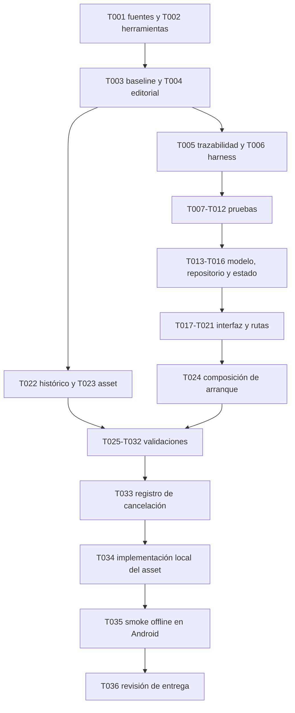

# Tasks: F04 — Tips educativos

**Input:** [plan técnico aprobado](plan.md), [spec](spec.md), [contenido1.0.0](contenido-editorial.md),
[modelo](data-model.md), [contratos](contracts/tips.md), [investigación](research.md)
y [guía de validación](quickstart.md).
**Fecha:** 2026-11-05. **Rama:** `work`. **Historia:** `[US1]` corresponde a HU-04(P1).
**Estado:** F04 aceptada y cerrada,36/36 tareas completadas.
Fuentes/herramientas/baseline, modelos/estado/UI/rutas y suites locales verificados.
Restan revalidación Flutter/build tras la migración, verificaciones nativas/humanas
y smoke offline. No hay publicación de Tips pendiente.
La aprobación del plan ya está registrada y no debe solicitarse otra vez.

Se incluyen pruebas porque el spec/plan las exigen. No se crean historias nuevas
por categoría: las cuatro integran HU-04. Los resultados de F01–F03 no acreditan F04.
No publicar servicios ni datos reales para ejecutar pruebas locales.

## Fase 1 — Preparación

**Objetivo:** resolver el bloqueo editorial y preparar herramientas sin alterar alcance.

- [x] T001 Completar consulta primaria y soporte por categoría en `specs/004-tips-educativos/fuentes-editoriales.md` tras aplicar los dominios guardados en el borrador de red; contrastar N1/C1/C2/F1/F2/F3/R1/H1, seleccionar artículos específicos para los índices, registrar URL/título/sección/fecha y aprobación ya concedida; si una fuente contradice texto aprobado, documentar la discrepancia antes de cambiarlo. CA-04.7–10; bloqueo de apertura de ejecución.
- [x] T002 Verificar/preparar Flutter3.47.8/Dart3.13.7, SDK Android API24/API36, Java21, Node y emulador Firestore; ejecutar preparación de `specs/004-tips-educativos/quickstart.md` y documentar versiones y bloqueos reales en `specs/004-tips-educativos/validation/environment.md`, sin actualizar dependencias/lockfile ni desactivar TLS/integridad.
- [x] T003 Registrar baseline de análisis, pruebas existentes y estado Git según `specs/004-tips-educativos/quickstart.md` en `specs/004-tips-educativos/validation/baseline.md`; separar defectos previos, entorno y pruebas nuevas aún inexistentes, sin atribuir recuentos históricos a esta ejecución.

## Fase 2 — Fundamentos y trazabilidad

**Puerta:** T001 resuelta y preparación suficiente antes de código de la historia.
Estos son artefactos de preparación, no autorización de despliegue ni aceptación.

- [x] T004 Consolidar fuentes verificadas y versión editorial1.0.0 en `specs/004-tips-educativos/contenido-editorial.md`, preservando textos del usuario+A1–A5; confirmar correspondencia literal P02–P06 con el asset posterior y dejar cerrada la condición editorial del plan sin inventar evidencia. RF-06.e, CA-04.10.
- [x] T005 Crear matriz RF-06.a–g→HU-04→CA-04.1–12/CA-ACC-01–05/SC-04.1–5→T001–T036→prueba→resultado en `specs/004-tips-educativos/validation/traceability.md`; iniciar resultados como pendientes y definir códigos estables de escenarios, sin marcar tareas ejecutadas por generar la matriz.
- [x] T006 Preparar dobles de repositorio/control de Futures y harness sintético en `mobile/test/features/tips/tips_test_fixtures.dart`, reutilizando `UiTestRepository` y composición PrivaApp para visitante/no verificado/válido; sin cuentas reales, endpoints de test ni persistencia de contenido de usuarios. C-TIPS-01–04.

## Fase 3 — US1 / HU-04: Consultar Tips (P1)

**Objetivo:** visitante o cuenta válida consulta catálogo y cuatro detalles, revela
explicaciones y vuelve, con errores recuperables y sin introducir datos personales.
**Prueba independiente:** cinco rutas públicas correctas, textos aprobados, estados
correctos, regreso al catálogo y cero acceso privado indebido; puede probarse con
dobles y emulador sin implementar F05–F07 ni tocar el proyecto alojado.

### Pruebas de contrato, estado e interfaz

Escribir pruebas significativas antes de la implementación afectada y demostrar
fallo del comportamiento esperado en un harness compilable, no solo fallo de import.

- [x] T007 [P] [US1] Crear pruebas de validación en `mobile/test/features/tips/tip_content_test.dart`: cuatro IDs/tipos de ejemplo, todos los campos/variantes/versión, exactamente tres recomendaciones, campos extra/vacíos/tipos incorrectos,32KiB UTF-8, versiones mixtas, identidad de entrada y comparación editorial; RF-06.a/b/e, C-TIPS-01.
- [x] T008 [P] [US1] Crear pruebas del asset en `mobile/test/features/tips/bundled_tips_repository_test.dart`: cuatro categorías en orden, detalle por ID, una sola decodificación, ruta desconocida y asset ausente/incompleto/inválido→unavailable; sin red ni cuenta. C-TIPS-01/02/03. Sustituye la prueba Firestore por cambio aprobado del2026-11-05.
- [x] T009 [P] [US1] Crear pruebas con Futures controlados en `mobile/test/features/tips/tips_controller_test.dart`: loading/ready/error/unavailable, timeout15s, reintento mismo destino, duplicados agrupados, respuesta antigua/dispose ignorados y explicación/visibilidad independientes. CA-04.2/3/6, C-TIPS-03/05.
- [x] T010 [P] [US1] Crear pruebas de catálogo/detalles/rutas en `mobile/test/features/tips/tips_screen_test.dart`: visitante/no verificado/válido×cinco rutas, atrás, apertura directa,20 reselecciones, desconocida, cobertura/regreso de PageRoute y diálogos; «Ver ejemplo» inline único, ejemplos inertes, guardado Perfil y guardas privadas conservados. CA-04.1–6/9/12, CA-ACC-01–05.
- [x] T011 [P] [US1] Evidencia histórica: crear suite `firebase/tests/tips.test.mjs` con datos sintéticos en emulador para las reglas Tips del diseño anterior. Esa suite se eliminó con el cambio al asset; solo la regresión de cuenta/evidencia/demo/suppression sigue vigente. C-TIPS-02, RF-06.c/g.
- [x] T012 [P] [US1] Crear pruebas de semántica/layout en `mobile/test/features/tips/tips_accessibility_test.dart`:320×720/412×915dp, texto100%/200%, labels por categoría, expanded, encabezados, selección Tips,48dp y sin recortes/inputs/acciones externas; verificar estados y explicaciones expandidas. CA-04.11, C-TIPS-06.

### Implementación

- [x] T013 [US1] Implementar modelo/validación en `mobile/lib/features/tips/data/tip_content.dart` según `data-model.md`: esquema/versiones/IDs cerrados, tres recomendaciones, ejemplos ficticios y validación editorial; clarification A4 solo en profiles y vacío en las otras categorías tras retirada explícita de A3 el2026-11-05. Rechazar campos/tipos/IDs/versiones inválidos y contenido superior a32KiB. C-TIPS-01.
- [x] T014 [US1] Definir lectura de catálogo/detalle y errores tipados recuperable/unavailable en `mobile/lib/features/tips/data/tips_repository.dart`, sin dependencia de AccountController ni exponer excepciones o rutas del asset a UI; incluir estado no disponible veraz cuando el asset no puede cargarse. C-TIPS-01/03.
- [x] T015 [US1] Implementar `mobile/lib/features/tips/data/bundled_tips_repository.dart` con mapa cerrado passwords/sharing/links/profiles desde `assets/content/tips-1.0.0.json`, validación completa, caché solo en memoria y sin red/sesión/Firestore; asset o ID inválido→unavailable. C-TIPS-01–03. Sustituye el adaptador Firestore por cambio aprobado del2026-11-05.
- [x] T016 [US1] Implementar `mobile/lib/features/tips/application/tips_controller.dart`: generación por carga, limpieza de dato anterior, reintento agrupado del mismo destino, ignorar Futures tardíos, timeout y dispose; estado solo en memoria con `exampleExpanded` y `passwordVisible`, sin UID, correos, historial o serialización. C-TIPS-03/05.
- [x] T017 [US1] Implementar `mobile/lib/features/tips/presentation/tips_catalog_screen.dart` según PDF4: título/introducción y Zyro existente, panel blanco único con cuatro entradas ordenadas, descripciones aprobadas y «Ver más»; reutilizar tema/scaffold, adaptabilidad200% y navegación vigente sin marco de teléfono. RF-06.a, CA-04.1/11.
- [x] T018 [US1] Implementar `mobile/lib/features/tips/presentation/tip_detail_screen.dart` según PDF6/8/9/10: título/descripción/recomendaciones, Ejemplo y Consejo; publicación, mensaje y perfil ficticios, máscara de contraseña y A4 visible. A3 fue retirada el2026-11-05; los textos del usuario prevalecen. RF-06.b/e, CA-04.2/7–11.
- [x] T019 [US1] Completar «Ver ejemplo» y control independiente Mostrar/Ocultar clave en `mobile/lib/features/tips/presentation/tip_detail_screen.dart`: explicación inline, expansión idempotente, semántica distinguible y scroll; URL `.example` inerte, sin abrir apps, copiar, formularios, datos reales ni permisos nuevos. C-TIPS-05/06.
- [x] T020 [US1] Integrar repositorio/pantallas en `mobile/lib/app/priva_app.dart` y `mobile/lib/app/account_router.dart`, preservando precedencia del builder de pruebas y guardas; habilitar solo cinco rutas Tips en `mobile/lib/features/navigation/data/destination_catalog.dart`, sin nuevo router ni liberar F05–F07. C-TIPS-04, CA-ACC-01–05.
- [x] T021 [US1] Integrar RouteAware en `mobile/lib/features/tips/presentation/tips_catalog_screen.dart` y `mobile/lib/features/tips/presentation/tip_detail_screen.dart`: didPushNext limpia/invalida, didPopNext recarga, dispose desuscribe; conservar observer Perfil y no limpiar por diálogos no PageRoute. Extender `mobile/lib/features/account/presentation/account_scaffold.dart` solo si hace falta encabezado propio, manteniendo API por defecto/regresiones. C-TIPS-04/06.
- [x] T022 [US1] Evidencia histórica: se prepararon reglas Firestore de Tips, pero el cambio aprobado del2026-11-05 las deja fuera de F04 y nunca se publicaron. Las reglas de cuenta/perfil permanecen intactas. C-TIPS-02.
- [x] T023 [US1] Incluir `mobile/assets/content/tips-1.0.0.json` con igualdad literal respecto a contenido1.0.0+A1–A5, cuatro IDs, dominio reservado, tres recomendaciones y ejemplos sintéticos. CA-04.2/7–10.
- [x] T024 [US1] Componer `BundledTipsRepository(rootBundle)` en `mobile/lib/main.dart`, independiente de Firebase/Auth y disponible offline, sin cambiar la composición Firebase de cuenta/perfil. Probar arranque sin Firebase y carga del asset. C-TIPS-01/02, RF-06.c/g.

**Checkpoint:** historia funciona localmente con dobles/asset incluido, sin afirmar
validación nativa/humana. Reejecutar pruebas fallidas tras cada cambio.

## Fase 4 — Validación transversal y entrega

**Puerta:** implementación integrada y pruebas específicas satisfactorias. Resultados
locales, nativos/humanos y smoke offline separados. No heredar las excepciones del
cierre F03.

- [x] T025 Reejecutar análisis y suite Flutter tras migrar a `BundledTipsRepository`:0 diagnósticos y180/180 pruebas satisfactorias. El responsable decidió explícitamente no generar un APK nuevo y aceptó cerrar con esa limitación; evidencia en `validation/flutter-results.md`.
- [x] T026 Evidencia histórica: ejecutar `npm test` desde `firebase/` con la suite tips y la regresión cuenta/perfil/demo en emulador demo-priva; registrar recuento y salida final en `specs/004-tips-educativos/validation/firestore-results.md`. Las pruebas de Tips se eliminaron con el cambio al asset; solo la regresión de cuenta/perfil/demo sigue vigente. No modificar reglas remotas para lograr pruebas locales.
- [x] T027 Validar recorrido Android físico: Motorola G22/Android12, cinco rutas, atrás, sesión, ejemplos, modo avión y TalkBack satisfactorios. El responsable aprobó explícitamente cerrar sin API24/API36 ni APK nuevo; limitación aceptada en `validation/android-matrix.md`. CA-ACC, SC-04.1–4.
- [x] T028 Comparar capturas sintéticas P02–P06 con PDF4/6/8/9/10 y contenido aprobado en320×720/412×915dp,100%/200%; verificar Zyro, jerarquía, paneles, contraste,48dp y ausencia de recortes. Suite/capturas satisfactorias y revisión del responsable confirmada tras retirar A3; evidencia en `validation/visual-review.md`.
- [x] T029 Ejecutar TalkBack en Android físico. El responsable reportó recorrido satisfactorio en Motorola G22/Android12: lectura, navegación, acciones y ejemplos correctos, sin pausas/errores; evidencia agregada en `validation/accessibility.md`. SC-04.4.
- [x] T030 Comprobar rendimiento en20 repeticiones del recorrido con asset local/offline. El responsable reportó las20 repeticiones sin pausas, errores ni respuesta perceptible superior a1s; no se conservaron tiempos individuales. Evidencia y límite en `validation/performance.md`.
- [x] T031 Ejecutar comprensión con5 participantes de40–60años, cubriendo ambos tramos40–52/53–60;5/5 lograron6/6 sin ayuda y sin defectos reportados. Solo agregados en `validation/comprehension.md`. SC-04.5.
- [x] T032 Revisar código/configuración: asset local sin tráfico/escritura/historial/inputs/permisos nuevos, sin sesión, cuestionario o IA; documentar flujo y límite de actualización por nueva APK en `validation/privacy-review.md`. RF-06.g, CA-04.9/12.
- [x] T033 Registrar el cambio aprobado a contenido fijo, cancelar publicación de Tips y conservar evidencia de que no se escribió nada en Firebase en `validation/publication.md`; no modificar Firebase de cuenta/perfil.
- [x] T034 Implementar y probar estáticamente el asset aprobado, `BundledTipsRepository`, composición con `rootBundle` y eliminación del adaptador Firestore de F04; conservar pantallas/rutas/textos.
- [x] T035 Verificar en Android real que catálogo, cuatro detalles, «Ver más», atrás y ejemplos funcionan con modo avión y sin sesión. Resultado satisfactorio en Motorola G22/Android12, sin pausas/errores; evidencia en `validation/hosted-smoke.md`.
- [x] T036 Consolidar trazabilidad, resultados, limitaciones y aceptación explícita en `validation/delivery-review.md`; actualizar `specs/README.md`, hacer commit y sincronizar `work`. El responsable indicó «apruebalo» y «acepto y finaliza» el2026-11-05. F05–F08 no quedan aceptadas.

## Dependencias y orden

- T001 quedó completada con el contraste editorial cerrado; T002 precede T003/T006 y
  la ejecución de pruebas. T003/T004 preceden fundamentos.
- T007–T012 son paralelizables en archivos distintos después de T005/T006; contrato
  de datos ya definido permite preparar tests independientemente.
- Dentro de implementación: T013→T014→T015/T016; T017/T018 requieren esos contratos;
  T019 sigue T018; T020/T021 siguen pantallas. T024 sigue integración y se valida con
  bootstrap. T022/T023 pueden prepararse después del editorial/modelo y antes de UI,
  pero deben quedar probados junto a toda la historia.
- T025 sigue integración completa y no sustituye Android/humanos; T026 solo conserva
  la regresión de cuenta/perfil/demo. T027 precede observaciones visuales/físicas.
  T030 requiere runner y dispositivos disponibles.
- T033/T034 quedaron completadas con la migración local; no requieren publicación.
  T025 debe preceder el smoke offline y la aceptación final.
- T036 puede documentar bloqueos antes del final, pero no marcar cierre hasta satisfacer
  criterios o aprobar cambios por su procedimiento. No se presume aplazamiento.

## Paralelismo previsto — sin delegación iniciada

Ejemplo para HU-04: tras fundamentos, desarrollar T007/T008/T009/T010/T012 en
sus archivos de test independientes; T011 corresponde al diseño Firestore histórico. Después del modelo, repositorio y estado pueden
revisarse separadamente antes de integrarlos. No paralelizar edición de
`account_router.dart`, `priva_app.dart`, `main.dart` ni pantallas compartidas sin coordinación.
Estos ejemplos describen dependencias, no autorizan lanzar agentes automáticamente.

## Estrategia de implementación

Un único MVP: catálogo y cuatro detalles públicos completos, no una categoría de
muestra presentada como entrega de F04. Progresar por cortes internos: contratos
probados→datos/estado→catálogo→detalles/ejemplos→integración→asset→validación real.
Mantener privados intactos; ninguna publicación automática por acabar un corte.
F05–F07 fuera de alcance; F08 transversal se satisface con controles propios F04.

## Recuento y revisión de formato

36 tareas:3 preparación,3 fundamentos,18 de HU-04,12 transversales/entrega.
Todas usan checkbox, ID secuencial, ruta concreta y `[US1]` solo en la fase de la
historia;6 tareas `[P]` de pruebas independientes.0 completadas al crear el archivo;28 completadas en esta revisión.
Un plan aprobado no prueba ejecución, compilación ni despliegue.

## Resultado de esta ejecución — 2026-11-05

Completadas: T001–T024, T026, T032, T033 y T034 (28/36). El baseline previo a la
migración registró182/182 Flutter,0 diagnósticos,24/24 reglas/preflight y APK debug
compilado; esos números no acreditan el cambio al asset. Nuevas pruebas funcionales,
contratos, recuperación/concurrencia y20 de layout/accesibilidad;135 pruebas previas
preservadas salvo adaptación del assert del título provisional al catálogo real. No
se deshabilitaron aserciones.

- T025 completada: analyze0 y180/180 pruebas; APK nuevo omitido por decisión aceptada.
- T026 histórica: sus3 pruebas de reglas Tips y4 de preflight se eliminaron; solo
  queda la regresión de cuenta/perfil/demo.
- T027 completada con Motorola G22/Android12; API24/API36 omitidas por aceptación explícita.
- T028 completada: capturas/tests sintéticos y confirmación visual del responsable
  tras retirar A3.
- T029 completada: TalkBack reportado satisfactorio en Motorola G22/Android12.
- T030 completada por validación manual reportada de20 repeticiones, sin pausas/errores;
  no se conservaron tiempos individuales.
- T031 completada:5/5 lograron6/6 sin ayuda, edades reportadas40–60 y ambos tramos.
- T032 completada: el asset no genera tráfico de Tips; límites documentados y aceptados.
- T033/T034 completadas: contenido fijo documentado y migración local implementada;
  no hubo ni se requiere publicación Firebase.
- T035 completada: smoke offline reportado satisfactorio en Motorola físico.
- T036 completada: aceptación final explícita y limitaciones consolidadas.

No se heredan excepciones F03. F04 queda cerrada con36/36 tareas; F05–F08 no se aceptan.
