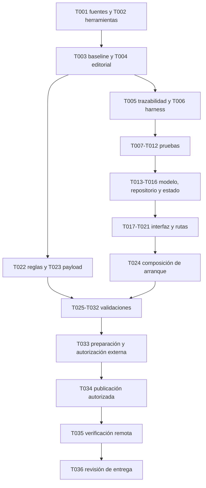

# Tasks: F04 — Tips educativos

**Input:** [plan técnico aprobado](plan.md), [spec](spec.md), [contenido1.0.0](contenido-editorial.md),
[modelo](data-model.md), [contratos](contracts/tips.md), [investigación](research.md)
y [guía de validación](quickstart.md).
**Fecha:** 2026-11-05. **Rama:** `work`. **Historia:** `[US1]` corresponde a HU-04(P1).
**Estado:** implementación local de HU-04 completada,26/36 tareas completadas.
Fuentes/herramientas/baseline, modelos/estado/UI/rutas/reglas y suites locales
verificados. Restan verificaciones nativas/humanas, privacidad remota y publicación.
La aprobación del plan ya está registrada y no debe solicitarse otra vez.

Se incluyen pruebas porque el spec/plan las exigen. No se crean historias nuevas
por categoría: las cuatro integran HU-04. Los resultados de F01–F03 no acreditan F04.
No publicar servicios ni datos reales para ejecutar pruebas locales.

## Fase 1 — Preparación

**Objetivo:** resolver el bloqueo editorial y preparar herramientas sin alterar alcance.

- [x] T001 Completar consulta primaria y soporte por categoría en `specs/004-tips-educativos/fuentes-editoriales.md` tras aplicar los dominios guardados en el borrador de red; contrastar N1/C1/C2/F1/F2/F3/R1/H1, seleccionar artículos específicos para los índices, registrar URL/título/sección/fecha y aprobación ya concedida; si una fuente contradice texto aprobado, documentar la discrepancia antes de cambiarlo. CA-04.7–10; bloqueo de apertura de ejecución.
- [x] T002 Verificar/preparar Flutter3.47.8/Dart3.13.7, SDK Android API24/API36, Java21, Node y emulador Firestore; ejecutar preparación de `specs/004-tips-educativos/quickstart.md` y documentar versiones y bloqueos reales en `specs/004-tips-educativos/validation/environment.md`, sin actualizar dependencias/lockfile ni desactivar TLS/integridad.
- [x] T003 Registrar baseline de análisis, pruebas existentes y estado Git según `specs/004-tips-educativos/quickstart.md` en `specs/004-tips-educativos/validation/baseline.md`; separar defectos previos, entorno y pruebas nuevas aún inexistentes, sin atribuir recuentos históricos a esta ejecución.

## Fase 2 — Fundamentos y trazabilidad

**Puerta:** T001 resuelta y preparación suficiente antes de código de la historia.
Estos son artefactos de preparación, no autorización de despliegue ni aceptación.

- [x] T004 Consolidar fuentes verificadas y versión editorial1.0.0 en `specs/004-tips-educativos/contenido-editorial.md`, preservando textos del usuario+A1–A5; confirmar correspondencia literal P02–P06 con el payload posterior y dejar cerrada la condición editorial del plan sin inventar evidencia. RF-06.e, CA-04.10.
- [x] T005 Crear matriz RF-06.a–g→HU-04→CA-04.1–12/CA-ACC-01–05/SC-04.1–5→T001–T036→prueba→resultado en `specs/004-tips-educativos/validation/traceability.md`; iniciar resultados como pendientes y definir códigos estables de escenarios, sin marcar tareas ejecutadas por generar la matriz.
- [x] T006 Preparar dobles de repositorio/control de Futures y harness sintético en `mobile/test/features/tips/tips_test_fixtures.dart`, reutilizando `UiTestRepository` y composición PrivaApp para visitante/no verificado/válido; sin cuentas reales, endpoints de test ni persistencia de contenido de usuarios. C-TIPS-01–04.

## Fase 3 — US1 / HU-04: Consultar Tips (P1)

**Objetivo:** visitante o cuenta válida consulta catálogo y cuatro detalles, revela
explicaciones y vuelve, con errores recuperables y sin introducir datos personales.
**Prueba independiente:** cinco rutas públicas correctas, textos aprobados, estados
correctos, regreso al catálogo y cero acceso privado indebido; puede probarse con
dobles y emulador sin implementar F05–F07 ni tocar el proyecto alojado.

### Pruebas de contrato, estado e interfaz

Escribir pruebas significativas antes de la implementación afectada y demostrar
fallo del comportamiento esperado en un harness compilable, no solo fallo de import.

- [x] T007 [P] [US1] Crear pruebas de validación en `mobile/test/features/tips/tip_content_test.dart`: cuatro IDs/tipos de ejemplo, todos los campos/variantes/versión, exactamente tres recomendaciones, campos extra/vacíos/tipos incorrectos,32KiB UTF-8, versiones mixtas, identidad de documento y comparación editorial; RF-06.a/b/e, C-TIPS-01.
- [x] T008 [P] [US1] Crear pruebas de lectura en `mobile/test/features/tips/firestore_tips_repository_test.dart`: cuatro gets paralelos de catálogo, uno de detalle, `Source.server`, sin list/listeners/cache/fallback, ausencia/incompleto y `permission-denied→unavailable`, otros fallos/timeout→error; cuenta no determina contenido. C-TIPS-01/02/03.
- [x] T009 [P] [US1] Crear pruebas con Futures controlados en `mobile/test/features/tips/tips_controller_test.dart`: loading/ready/error/unavailable, timeout15s, reintento mismo destino, duplicados agrupados, respuesta antigua/dispose ignorados y explicación/visibilidad independientes. CA-04.2/3/6, C-TIPS-03/05.
- [x] T010 [P] [US1] Crear pruebas de catálogo/detalles/rutas en `mobile/test/features/tips/tips_screen_test.dart`: visitante/no verificado/válido×cinco rutas, atrás, apertura directa,20 reselecciones, desconocida, cobertura/regreso de PageRoute y diálogos; «Ver ejemplo» inline único, ejemplos inertes, guardado Perfil y guardas privadas conservados. CA-04.1–6/9/12, CA-ACC-01–05.
- [x] T011 [P] [US1] Crear suite `firebase/tests/tips.test.mjs` con datos sintéticos en emulador: get público de cuatro aprobados y ausencia conocida, denegación de ID arbitrario/draft/esquema/versión inválidos, list y toda escritura cliente; verificar que cuenta/evidencia/demo/suppression mantienen restricciones. C-TIPS-02, RF-06.c/g.
- [x] T012 [P] [US1] Crear pruebas de semántica/layout en `mobile/test/features/tips/tips_accessibility_test.dart`:320×720/412×915dp, texto100%/200%, labels por categoría, expanded, encabezados, selección Tips,48dp y sin recortes/inputs/acciones externas; verificar estados y explicaciones expandidas. CA-04.11, C-TIPS-06.

### Implementación

- [x] T013 [US1] Implementar modelo/validación en `mobile/lib/features/tips/data/tip_content.dart` según `data-model.md`: `schemaVersion` «Entero1; cualquier otro valor, unavailable»; `contentVersion` «String tips-1.0.0»; `categoryId` «String igual al ID del documento y del mapa cerrado»; `status` «Literal approved»; `catalogTitle` «String del mapa anterior, no intercambiable con título de detalle»; `description` «Descripción literal aprobada, usada también como resumen del catálogo»; `title` «Título principal aprobado de cada detalle»; `panelTitle` «Pregunta aprobada que encabeza recomendaciones»; `recommendations` «Lista de exactamente3 strings no vacíos y ordenados»; `example` solo variante ficticia permitida; `explanation` literal con A1; `advice` literal con A5; `clarification` A3/A4 o vacío según categoría; `editorialReview` con version1.0.0, approvedOn2026-11-04 y sourceIds verificadas. Rechazar «campos extra, tipos incorrectos, texto vacío obligatorio, IDs desconocidos, contenido superior a32KiB UTF-8 por documento ni versiones mixtas». C-TIPS-01.
- [x] T014 [US1] Definir lectura de catálogo/detalle y errores tipados recuperable/unavailable en `mobile/lib/features/tips/data/tips_repository.dart`, sin dependencia de AccountController ni exponer FirebaseException/snapshots a UI; incluir fallback no disponible para Core fallido con contrato de reintento veraz. C-TIPS-01/03.
- [x] T015 [US1] Implementar `mobile/lib/features/tips/data/firestore_tips_repository.dart` con mapa cerrado passwords/sharing/links/profiles, cuatro get paralelos o uno por detalle mediante `GetOptions(source:Source.server)`, timeout15s, catálogo completo/versionado y sin escritura/list/listeners/fallback; `permission-denied` como unavailable sin inferir causa. C-TIPS-01–03.
- [x] T016 [US1] Implementar `mobile/lib/features/tips/application/tips_controller.dart`: generación por carga, limpieza de dato anterior, reintento agrupado del mismo destino, ignorar Futures tardíos, timeout y dispose; estado solo en memoria con `exampleExpanded` y `passwordVisible`, sin UID, correos, historial o serialización. C-TIPS-03/05.
- [x] T017 [US1] Implementar `mobile/lib/features/tips/presentation/tips_catalog_screen.dart` según PDF4: título/introducción y Zyro existente, panel blanco único con cuatro entradas ordenadas, descripciones aprobadas y «Ver más»; reutilizar tema/scaffold, adaptabilidad200% y navegación vigente sin marco de teléfono. RF-06.a, CA-04.1/11.
- [x] T018 [US1] Implementar `mobile/lib/features/tips/presentation/tip_detail_screen.dart` según PDF6/8/9/10: título/descripción/recomendaciones, Ejemplo y Consejo; publicación, mensaje y perfil genéricos ficticios del contenido aprobado, máscara de contraseña y A3/A4 visibles; textos del usuario prevalecen sobre los históricos del PDF. RF-06.b/e, CA-04.2/7–11.
- [x] T019 [US1] Completar «Ver ejemplo» y control independiente Mostrar/Ocultar clave en `mobile/lib/features/tips/presentation/tip_detail_screen.dart`: explicación inline, expansión idempotente, semántica distinguible y scroll; URL `.example` inerte, sin abrir apps, copiar, formularios, datos reales ni permisos nuevos. C-TIPS-05/06.
- [x] T020 [US1] Integrar repositorio/pantallas en `mobile/lib/app/priva_app.dart` y `mobile/lib/app/account_router.dart`, preservando precedencia del builder de pruebas y guardas; habilitar solo cinco rutas Tips en `mobile/lib/features/navigation/data/destination_catalog.dart`, sin nuevo router ni liberar F05–F07. C-TIPS-04, CA-ACC-01–05.
- [x] T021 [US1] Integrar RouteAware en `mobile/lib/features/tips/presentation/tips_catalog_screen.dart` y `mobile/lib/features/tips/presentation/tip_detail_screen.dart`: didPushNext limpia/invalida, didPopNext recarga, dispose desuscribe; conservar observer Perfil y no limpiar por diálogos no PageRoute. Extender `mobile/lib/features/account/presentation/account_scaffold.dart` solo si hace falta encabezado propio, manteniendo API por defecto/regresiones. C-TIPS-04/06.
- [x] T022 [US1] Ampliar `firebase/firestore.rules` exclusivamente para get público de cuatro IDs conocidos approved/schema1/tips-1.0.0 y ausencia conocida; denegar list y create/update/delete de clientes, conservar demo_contact/privacy_suppressions/authorization_evidence/profiles y denegación por defecto. C-TIPS-02.
- [x] T023 [US1] Crear payload público `firebase/content/tips-1.0.0.json` con cuatro documentos completos según modelo, igualdad literal con contenido1.0.0+A1–A5 y fuentes verificadas; dominio reservado inerte, tres recomendaciones y ejemplos sintéticos, sin identidad de revisor/lectores. Comparar payload con las pruebas editoriales antes de cualquier publicación. CA-04.2/7–10.
- [x] T024 [US1] Componer repositorio Tips en `mobile/lib/main.dart` desde Core inicializado con `persistenceEnabled:false`, independientemente del éxito de Auth/autorización; si falla Core, fallback honesto con reintento seguro; sin cambiar identidad/proyecto, pins, sesión existente ni configuración privilegiada. Probar estos casos en `mobile/test/bootstrap_test.dart`. C-TIPS-01/02, RF-06.c/g.

**Checkpoint:** historia funciona localmente con dobles/emulador, sin afirmar
publicación ni validación nativa/humana. Reejecutar pruebas fallidas tras cada cambio.

## Fase 4 — Validación transversal y entrega

**Puerta:** implementación integrada y pruebas específicas satisfactorias. Resultados
nativos/humanos/hosted separados. No heredar las excepciones del cierre F03.

- [x] T025 Ejecutar análisis y suite Flutter completa desde `mobile/` según `specs/004-tips-educativos/quickstart.md`; registrar comando/build/recuento real, incluidos F04 y regresiones F01–F03, en `specs/004-tips-educativos/validation/flutter-results.md`, con fallos y repruebas, no solo salida cero sin tests.
- [x] T026 Ejecutar `npm test` desde `firebase/` con la suite tips y toda la regresión cuenta/perfil/demo en emulador demo-priva; registrar tests realmente ejecutados/pasados/fallidos/omitidos y salida final en `specs/004-tips-educativos/validation/firestore-results.md`. No modificar reglas remotas para lograr pruebas locales.
- [ ] T027 Crear y ejecutar recorrido Android sintético en `mobile/integration_test/tips_test.dart`, compilar APK debug y cubrir cinco rutas/atrás/sesión/estado/ejemplos en API24/API36 según matriz; documentar modelo/OS/geometría/build y pendientes reales en `specs/004-tips-educativos/validation/android-matrix.md`. CA-ACC, SC-04.1–4.
- [ ] T028 Comparar capturas sintéticas P02–P06 con PDF4/6/8/9/10 y contenido aprobado en320×720/412×915dp,100%/200%; verificar imagen Zyro existente/fondo, jerarquía/paneles/contraste4.5:1 normal y3:1 grande/controles,48dp y ausencia de recortes, registrar defectos/repruebas en `specs/004-tips-educativos/validation/visual-review.md`. No alterar wireframes o textos para disimular incumplimientos.
- [ ] T029 Ejecutar TalkBack en al menos un Android físico: lectura/orden/foco, selección Tips, acciones por categoría, expansión de explicación, máscara y carga/error/reintento; registrar configuración y observaciones sin datos de cuenta en `specs/004-tips-educativos/validation/accessibility.md`, diferenciando semántica automática de prueba real. SC-04.4.
- [ ] T030 Crear runner `mobile/integration_test/tips_performance_test.dart` y medir20 repeticiones por operación/configuración de catálogo/detalle/reintento/revelado según quickstart, reloj monotónico, feedback≤1s y contenido/error≤15s; registrar todas las duraciones sanitizadas/máximo/incumplimientos y perfil de red en `specs/004-tips-educativos/validation/performance.md`, sin sustituir medición por media o timeout configurado.
- [ ] T031 Ejecutar protocolo de comprensión del quickstart con5 participantes de40–65años y ambos tramos incluidos; meta≥4/5 con seis comprobaciones correctas sin ayuda; registrar solo agregados/build/defectos en `specs/004-tips-educativos/validation/comprehension.md`, sin nombres/respuestas individuales/grabaciones ni agentes como sustituto. SC-04.5.
- [ ] T032 Revisar código/configuración y tráfico sintético, ausencia de escritura/historial/inputs/permisos nuevos, no persistencia Firestore y no uso de cuestionario/IA; revisar metadatos/logs del proveedor y política aplicable sin prometer ausencia de registros; documentar flujo y límites en `specs/004-tips-educativos/validation/privacy-review.md`. RF-06.g, CA-04.9/12.
- [ ] T033 Preparar publicación acotada en `firebase/README.md` para cuatro documentos y reglas, comprobar nombres/presencia de configuración y acceso administrativo existente por canales seguros sin imprimir valores ni pedir claves por chat; registrar prerrequisitos y respaldo de contenido/reglas existentes en `specs/004-tips-educativos/validation/publication.md`. No interpretar aprobación de arquitectura como autorización de despliegue.
- [ ] T034 Solo tras autorización explícita del responsable para el servicio real, publicar las reglas revisadas y cuatro documentos de `firebase/content/tips-1.0.0.json`, preservando el resto de priva-785cb y registrar versión/alcance/resultado en `specs/004-tips-educativos/validation/publication.md`; sin autorización o credencial, dejar pendiente y no inventar publicación.
- [ ] T035 Tras T034, verificar lectura pública real de cuatro categorías, denegación de escritura/list y uso Android con datos sintéticos, carga/reintento e independencia de sesión; registrar resultado remoto separado del emulador en `specs/004-tips-educativos/validation/hosted-smoke.md`, sin crear cuentas/personas reales ni modificar evidencia para simular autorización.
- [ ] T036 Consolidar trazabilidad, checklist de criterios, resultados/fallos/pendientes y aceptación explícita de entrega en `specs/004-tips-educativos/validation/delivery-review.md`; actualizar `specs/README.md`, hacer commit y sincronizar `work` antes de cerrar, sin declarar terminado F04 si hay criterios pendientes o sin aceptar F05–F08.

## Dependencias y orden

- T001 bloquea implementación por el plan aprobado y constituciónIX; su revisión
  pendiente no se resuelve por generar tareas ni por aprobar el diseño técnico.
- T002 precede T003/T006 y la ejecución de pruebas. T003/T004 preceden fundamentos.
- T007–T012 son paralelizables en archivos distintos después de T005/T006; contrato
  de datos ya definido permite preparar tests independientemente.
- Dentro de implementación: T013→T014→T015/T016; T017/T018 requieren esos contratos;
  T019 sigue T018; T020/T021 siguen pantallas. T024 sigue integración y se valida con
  bootstrap. T022/T023 pueden prepararse después del editorial/modelo y antes de UI,
  pero deben quedar probados junto a toda la historia.
- T025/T026 siguen integración completa y no sustituyen Android/humanos; T027 precede
  observaciones visuales/físicas. T030 requiere runner y dispositivos disponibles.
- T033 puede preparar documentación mientras termina validación independiente;
  T034 exige pruebas previas satisfactorias y autorización de publicación, no silencio.
- T036 puede documentar bloqueos antes del final, pero no marcar cierre hasta satisfacer
  criterios o aprobar cambios por su procedimiento. No se presume aplazamiento.

## Paralelismo previsto — sin delegación iniciada

Ejemplo para HU-04: tras fundamentos, desarrollar T007/T008/T009/T010/T011/T012 en
sus archivos de test independientes. Después del modelo, repositorio y estado pueden
revisarse separadamente antes de integrarlos. No paralelizar edición de
`account_router.dart`, `priva_app.dart`, `main.dart` ni pantallas compartidas sin coordinación.
Estos ejemplos describen dependencias, no autorizan lanzar agentes automáticamente.

## Estrategia de implementación

Un único MVP: catálogo y cuatro detalles públicos completos, no una categoría de
muestra presentada como entrega de F04. Progresar por cortes internos: contratos
probados→datos/estado→catálogo→detalles/ejemplos→integración→reglas→validación real.
Mantener privados intactos; ninguna publicación automática por acabar un corte.
F05–F07 fuera de alcance; F08 transversal se satisface con controles propios F04.

## Recuento y revisión de formato

36 tareas:3 preparación,3 fundamentos,18 de HU-04,12 transversales/entrega.
Todas usan checkbox, ID secuencial, ruta concreta y `[US1]` solo en la fase de la
historia;6 tareas `[P]` de pruebas independientes.0 completadas al crear el archivo;26 completadas en esta revisión.
Un plan aprobado no prueba ejecución, compilación ni despliegue.

## Resultado de esta ejecución — 2026-11-05

T001–T026 completadas.182/182 Flutter,0 diagnósticos;24/24 reglas/preflight y APK debug
compilado. Nuevas pruebas funcionales, contratos, recuperación/concurrencia y20 de
layout/accesibilidad;135 pruebas previas preservadas salvo adaptación del assert del
título provisional al catálogo real. No se deshabilitaron aserciones.

- T027 parcial: APK y runner preparados, sin matriz Android ejecutada.
- T028 parcial: revisión/capturas sintéticas y tamaños/texto probados; falta contraste
  visual nativo de detalles/ejemplos/consejos completos.
- T029 pendiente: TalkBack físico.
- T030 parcial: runner20 muestras preparado/analizado; sin muestras nativas.
- T031 pendiente:5 participantes.
- T032 parcial: flujos/código/tests revisados; tráfico nativo/logs remotos sin inspección.
- T033 parcial: documentación/helper respaldado y probado; no hay identidad administrativa
  verificada ni respaldo de reglas hospedadas.
- T034/T035 pendientes: autorización/publicación y verificación remota. No se ejecutó
  ninguna escritura ni despliegue de producción.
- T036 parcial: trazabilidad/revisión de entrega preparadas y sincronización de esta
  implementación; falta aceptación final y completar criterios pendientes.

No se heredan excepciones F03 ni se declaran cerradas las36 tareas.
